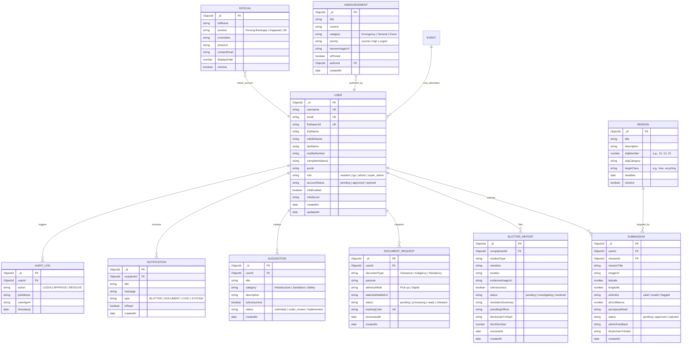

# 🗄️ Barangay Bagong Pag-asa E-Services (BrgyLink): Database Schema & ERD

**Database Engine:** MongoDB Atlas (v7.0+) • **Object Data Modeling (ODM):** Mongoose (v8.0+) • **Storage Security:** AES-256

---

## 📊 1. Entity-Relationship Diagram (ERD)

---

## 📑 2. Data Dictionary

### 2.1 `User` Collection (`users`)
| Field Name | Type | Index | Required | Default | Description / Constraints |
| :--- | :--- | :---: | :---: | :---: | :--- |
| `_id` | `ObjectId` | Primary Key | Yes | Auto | Unique MongoDB Identifier |
| `username` | `String` | Unique (`IXSCAN`) | Yes | None | Unique citizen handle |
| `email` | `String` | Unique (`IXSCAN`) | Yes | None | RFC 5322 email |
| `firebaseUid` | `String` | Unique (`IXSCAN`) | Yes | None | Firebase Authentication user identifier. Firebase, not MongoDB, stores the password credential. |
| `firstName`, `middleName`, `lastName`, `suffix` | `String` | No | First/last required | None | Resident legal-name fields used by signup and profile editing. |
| `birthDate`, `age` | `Date`, `Number` | No | Yes | None | Validated date of birth and calculated age; resident registration requires age 15 or older. |
| `mobileNumber` | `String` | No | Yes | None | Resident contact number. |
| `completeAddress`, `purok` | `String` | No | Yes | None | Resident address. Purok supports the confirmed Purok 1–7 directory and a controlled Other value. |
| `idType` | `String` | No | Yes | None | Valid government ID type; PhilSys National ID/ePhilID is preferred in the app. |
| `validIdFrontUrl`, `validIdBackUrl` | `String` | No | Yes | None | Securely stored ID attachment references for barangay review. |
| `role` | `String` | Single (`IXSCAN`) | Yes | `'resident'` | Enum: `['resident', 'lgu', 'admin', 'super_admin']` |
| `accountStatus` | `String` | Single (`IXSCAN`) | Yes | `'pending'` | Enum: `['pending', 'approved', 'rejected']`; an approved status is required for resident access. |
| `rejectionReason` | `String` | No | Conditional | None | Clear administrator reason retained when the account is rejected (maximum 500 characters). |
| `mfaEnabled` | `Boolean` | No | No | `false` | Account preference; signup email verification is stored separately. |
| `legalConsent` | `Boolean` | No | Yes | `false` | Records accepted Privacy Notice and Terms of Use consent. |
| `createdAt` | `Date` | No | Yes | `Date.now` | Registration timestamp |

---

### 2.2 `Submission` Collection (`submissions`)
| Field Name | Type | Index | Required | Default | Description / Constraints |
| :--- | :--- | :---: | :---: | :---: | :--- |
| `_id` | `ObjectId` | Primary Key | Yes | Auto | Unique Submission ID |
| `userId` | `ObjectId` | Compound Index | Yes | None | References `User._id` |
| `missionId` | `ObjectId` | Single (`IXSCAN`) | Yes | None | References `Mission._id` |
| `imageUrl` | `String` | No | Yes | None | Cloudinary CDN media link |
| `aiVerdict` | `String` | Single (`IXSCAN`) | No | `'pending'` | Enum: `['valid', 'invalid', 'flagged']` |
| `aiConfidence` | `Number` | No | No | `0.0` | Probability float ($0.0 \le x \le 1.0$) |
| `perceptualHash`| `String` | Single (`IXSCAN`) | No | None | 64-bit hexadecimal pHash |
| `status` | `String` | Compound Index | Yes | `'pending'` | Enum: `['pending', 'approved', 'rejected']` |

---

### 2.3 `BlotterReport` Collection (`blotters`)
| Field Name | Type | Index | Required | Default | Description / Constraints |
| :--- | :--- | :---: | :---: | :---: | :--- |
| `_id` | `ObjectId` | Primary Key | Yes | Auto | Unique Blotter Record ID |
| `complainantId`| `ObjectId` | Single (`IXSCAN`) | Yes | None | References `User._id` |
| `incidentType` | `String` | No | Yes | None | Category of incident |
| `narrative` | `String` | Text Search | Yes | None | Detailed testimony statement |
| `status` | `String` | Compound Index | Yes | `'pending'` | Enum: `['pending', 'investigating', 'resolved']` |
| `blockchainTxHash`| `String`| Single (`IXSCAN`) | No | `null` | Cryptographic Sepolia anchor |
| `blockNumber` | `Number` | No | No | `null` | Block height where minted |
